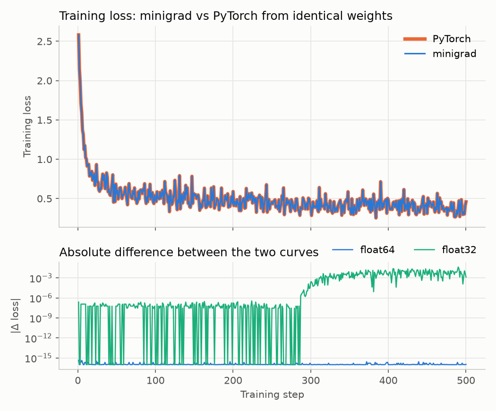
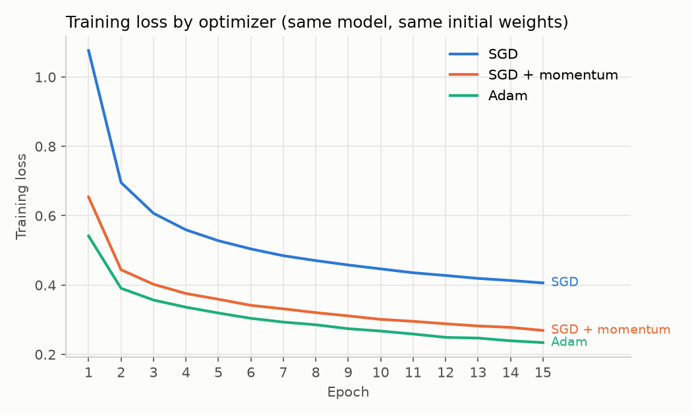
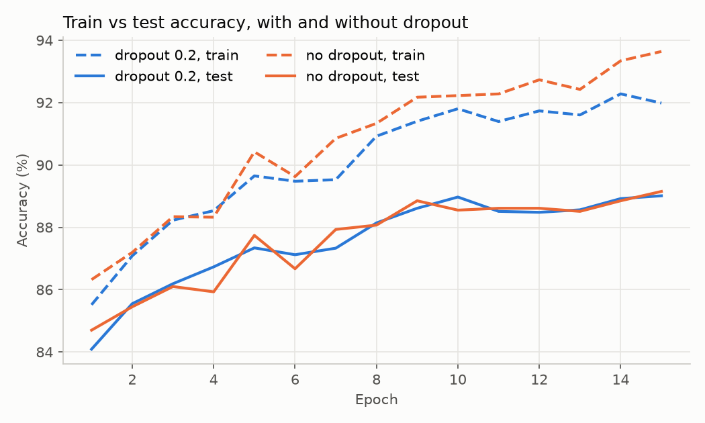

# numpy-autograd

[](https://github.com/YeganehGhaderi/numpy-autograd/actions/workflows/tests.yml)

**A tensor-level reverse-mode autograd engine in pure NumPy, verified against PyTorch.**

`minigrad` builds a computation graph as you compute, then runs backpropagation through it.
On top of the engine it implements the pieces needed to train real networks: Linear layers,
activations, Dropout, cross-entropy losses, and SGD, Momentum and Adam optimizers.
The library depends on NumPy only; PyTorch is used solely to check the results.



*Same initial weights, same batches, same optimizer (Adam). In float64 the two loss curves agree
to **4.4 × 10⁻¹⁶** over 500 training steps, the limit of float64 precision. In float32 they agree
to within about 10⁻⁷ (often exactly) for roughly the first 290 steps and then separate;
see [Design notes](#why-float32-runs-drift-apart).*

---

## Features

| | |
|---|---|
| **Tensor operations** | `+ - * /`, `@` (matmul), `sum`, `mean`, `reshape`, `transpose`, indexing, `exp`, `log`, `**`, `relu`, `sigmoid`, `tanh`, `softmax`, `log_softmax` |
| **Broadcasting** | Full NumPy broadcasting in the forward pass, with gradients summed back to each input's shape |
| **Losses** | Fused, numerically stable softmax cross-entropy and sigmoid binary cross-entropy |
| **Layers** (`minigrad.nn`) | `Linear` (He initialisation), `ReLU`, `Sigmoid`, `Tanh`, `Dropout`, `Sequential`, `CrossEntropyLoss`, `BCEWithLogitsLoss` |
| **Optimizers** (`minigrad.optim`) | `SGD`, SGD with momentum, `Adam` (update rules identical to `torch.optim`) |
| **Utilities** | `no_grad()` context for evaluation, `train()` / `eval()` modes |

## Example

```python
import numpy as np
from minigrad import Tensor, nn, optim

model = nn.Sequential(nn.Linear(784, 256), nn.ReLU(), nn.Dropout(0.2),
                      nn.Linear(256, 128), nn.ReLU(), nn.Linear(128, 10))
opt = optim.Adam(model.parameters(), lr=1e-3)
loss_fn = nn.CrossEntropyLoss()

for xb, yb in batches:                    # xb: (128, 784) float32, yb: (128,) int labels
    opt.zero_grad()
    loss = loss_fn(model(Tensor(xb)), yb)
    loss.backward()                       # reverse-mode autodiff through the whole graph
    opt.step()
```

## How it's verified

Every claim is backed by **75 tests**, run by GitHub Actions on Python 3.10 and 3.12 at each push.

1. **Against PyTorch.** Each operation is run in both libraries on the same float64 inputs; outputs
   and gradients must agree to a relative tolerance of 10⁻⁶. Binary operations are tested on several
   broadcasting patterns (`(3,4)+(4,)`, `(4,1)+(1,5)`, tensor + scalar). Whole models (`Linear`,
   a three-layer MLP with cross-entropy) and the optimizers (5 steps of SGD, Momentum and Adam)
   are compared the same way.
2. **Against finite differences.** Independently of PyTorch, gradients are compared with the
   numerical derivative `(f(x+h) − f(x−h)) / 2h` in float64.
3. **Behaviour.** Dropout (identity in eval mode, mean preserved in train mode, gradient equal to the
   mask), dtype handling, `no_grad`, gradient accumulation, and an end-to-end test where an MLP
   must learn XOR.

```bash
pip install -r requirements-dev.txt && pip install -e .
pytest
```

## Results

All numbers come from the scripts in [`experiments/`](experiments), with a fixed seed, on one laptop CPU.
Dataset: [Fashion-MNIST](https://github.com/zalandoresearch/fashion-mnist) (60,000 training and 10,000 test images, 10 classes).

### minigrad vs PyTorch

| | Test accuracy | Time per epoch |
|---|---|---|
| minigrad | 89.01% | 8.3 s |
| PyTorch (CPU) | 88.66% | 1.6 s |

MLP `784 → 256 → 128 → 10` with Dropout 0.2, Adam (lr 10⁻³), batch 128, 15 epochs, same initial
weights and batch order. The small accuracy gap comes from the two libraries drawing different
random dropout masks. **PyTorch is 5.3× faster**, which is expected: minigrad manages the graph in
Python, allocates a new array for every operation, and runs each step separately, whereas PyTorch
builds the graph in C++, reuses memory and uses fused, optimised kernels.

### Optimizers



| Optimizer | Final training loss | Test accuracy |
|---|---|---|
| SGD (lr 10⁻²) | 0.406 | 85.20% |
| SGD + momentum 0.9 (lr 10⁻²) | 0.269 | 87.84% |
| Adam (lr 10⁻³) | 0.234 | 89.01% |

### Dropout



| | Train accuracy | Test accuracy | Gap |
|---|---|---|---|
| No dropout | 93.64% | 89.15% | 4.5 points |
| Dropout 0.2 | 91.98% | 89.01% | 3.0 points |

Dropout narrowed the train–test gap (less overfitting) but did not raise test accuracy within 15 epochs.

### Baselines

| Model | Dataset | Test accuracy |
|---|---|---|
| Logistic regression, minigrad | Breast cancer (sklearn) | 97.37% |
| Logistic regression, scikit-learn | Breast cancer (sklearn) | 98.25% |
| Softmax regression `Linear(784, 10)` | Fashion-MNIST | 83.47% |
| MLP (above) | Fashion-MNIST | 89.01% |

The single-layer softmax model is the baseline the MLP improves on by 5.5 points.
On breast cancer the 0.9-point gap is one test patient out of 114; scikit-learn applies L2
regularisation by default, minigrad's model does not.

### Reproduce

```bash
python experiments/logistic_regression.py
python experiments/train_mlp.py        # optimizers and dropout
python experiments/compare_pytorch.py  # lockstep curves and speed (run after train_mlp.py)
```

## Design notes

### Broadcasting in the backward pass
When a `(5,)` bias is added to a `(32, 5)` batch, NumPy silently copies the bias to all 32 rows.
Each bias entry was used 32 times, so its gradient is the **sum** over those rows. `_unbroadcast`
sums the incoming gradient over every axis that was added or stretched, returning it to the
input's original shape. Without it, `Linear` layers would get wrongly shaped bias gradients.

### Gradient accumulation
A tensor used in several places (`x * x + x`) receives one gradient contribution per use. By the
multivariable chain rule these contributions add up, so gradients are accumulated (`+=`), never
overwritten. The backward pass visits nodes in reverse topological order, so a node passes its
gradient on only after every node that used it has contributed.

### Fused softmax cross-entropy
Softmax followed by log is unstable: `exp(1000)` overflows. Subtracting the row maximum first
changes nothing mathematically (the factor cancels) but keeps every exponent ≤ 0. Fusing the
loss also gives a very simple gradient with respect to the logits:

```
d(loss)/d(logits) = (softmax(logits) − one_hot(targets)) / N
```

The library also contains `cross_entropy_composed`, the same loss built from `log_softmax`,
indexing and `mean`; the tests show that both versions match PyTorch, i.e. this formula is exactly
what the chain rule produces. Binary cross-entropy is fused with the sigmoid in the same way,
giving `(sigmoid(z) − y) / N`.

### Inverted dropout
During training each activation is zeroed with probability *p* and the survivors are scaled by
1/(1 − *p*), so the expected activation is unchanged. At evaluation time dropout is therefore the
identity and nothing needs rescaling. Its backward pass needs no extra code: dropout is a
multiplication by a fixed mask, so its gradient is the mask.

### Why float32 runs drift apart
In float32 the two libraries agree to within ~2 × 10⁻⁷ (often exactly) for roughly the first
290 steps; then the difference jumps and stays around 10⁻³–10⁻², reaching 4.3 × 10⁻² at most. This is not a bug: running minigrad against *itself* in float32 vs
float64 shows the same drift, while two float64 runs that differ by 10⁻¹⁵ stay 10⁻¹⁵ apart. The
two libraries sum numbers in a different order, so their float32 results differ in the last bits,
and Adam amplifies this: it divides each update by the running size of that parameter's gradient,
so a tiny gradient whose sign flips through rounding still produces a full-size step in the other
direction. In float64 the rounding is too small to matter, which is why the correctness check
runs in float64.

## Limitations

- CPU only, and about 5× slower than PyTorch on CPU.
- `matmul` supports 2-D tensors only; there are no convolution or recurrent layers.
- The graph is rebuilt on every forward pass and kept until the next one (no graph freeing).

## Acknowledgment

Inspired by Andrej Karpathy's [micrograd](https://github.com/karpathy/micrograd). micrograd
differentiates **scalars**, one number per graph node. minigrad works on **tensors**: every node
is a NumPy array, so it needs matrix calculus for `matmul`, gradient reduction for broadcasting,
numerically stable fused losses, and it is fast enough to train a 235,000-parameter network on
Fashion-MNIST.

## Project structure

```
minigrad/         tensor.py (engine and operations), nn.py (layers, losses), optim.py (optimizers)
tests/            test_ops.py (vs PyTorch), test_numerical.py (finite differences), test_nn.py, test_optim.py, ...
experiments/      logistic_regression.py, train_mlp.py, compare_pytorch.py
results/          plots and raw numbers (JSON) produced by the experiments
```

## License

MIT
